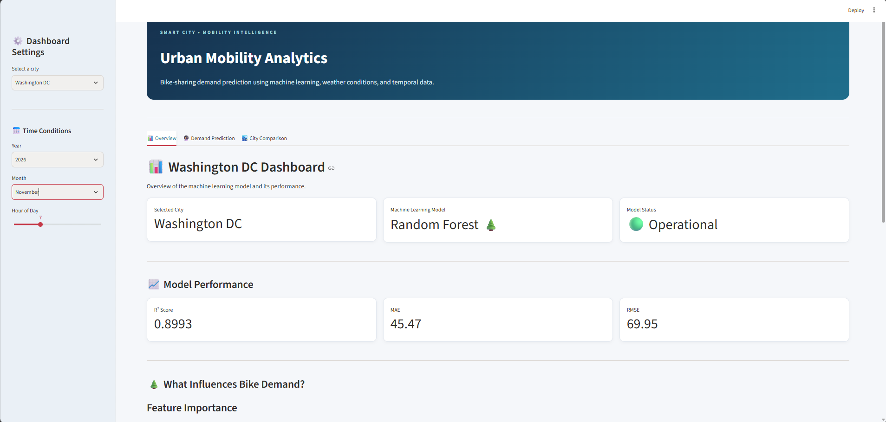
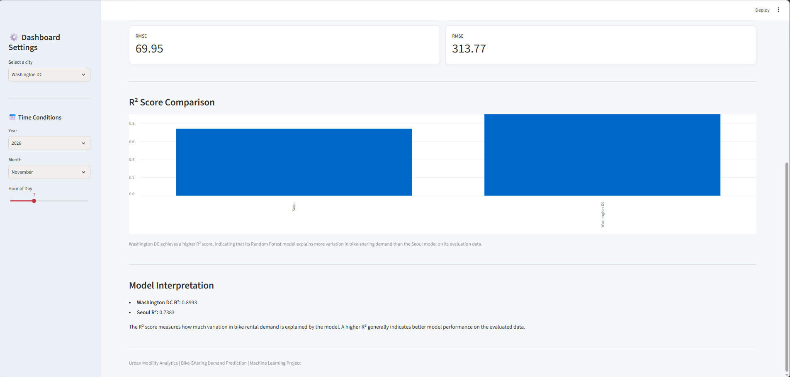

# Urban Mobility Analytics
### Bike-Sharing Demand Prediction Using Weather and Temporal Data

A machine learning project that analyzes and predicts bike-sharing demand using weather conditions and temporal features. The project compares bike rental demand patterns and prediction performance across two cities: **Washington DC** and **Seoul**.


The application provides an interactive dashboard built with Streamlit, allowing users to explore model performance, adjust weather and time conditions, and generate bike demand predictions.

---

**Project Type:** Individual MSc Project  
**Domain:** Machine Learning · Urban Mobility · Data Analytics  
**Models:** Random Forest Regression  
**Cities:** Washington DC 🇺🇸 · Seoul 🇰🇷

## Table of Contents

- [Project Objectives](#project-objectives)
- [Datasets](#datasets)
- [Technologies & Tools](#technologies--tools)
- [Machine Learning Methodology](#machine-learning-methodology)
- [Model Results & Performance](#model-results--performance)
- [Project Structure](#project-structure)
- [Dashboard Features](#dashboard-features)
- [Dashboard Preview](#dashboard-preview)
- [Installation & Setup](#installation--setup)
- [Usage Guide](#usage-guide)
- [Limitations & Future Improvements](#limitations--future-improvements)
- [Conclusion](#conclusion)

## Project Objectives

The main objectives of this project are:

- Analyze bike-sharing demand using weather-related and temporal data.
- Explore the relationship between environmental conditions and bike rental behavior.
- Develop machine learning models to predict bike-sharing demand.
- Train and evaluate Random Forest regression models for Washington DC and Seoul.
- Compare the predictive performance of the models using R², Mean Absolute Error (MAE), and Root Mean Squared Error (RMSE).
- Identify the most influential features affecting bike rental demand.
- Develop an interactive dashboard that allows users to explore conditions and generate demand predictions.

## Datasets

This project uses two bike-sharing datasets from different cities to analyze and predict rental demand.

### 1. Washington DC — Capital Bikeshare

The Washington DC dataset contains bike-sharing rental information, including temporal variables, weather conditions, and calendar-related features.

**Features include:**
- Season, year, month, and hour
- Holiday and working-day information
- Weather situation
- Temperature and feels-like temperature
- Humidity
- Wind speed

**Target variable:** Bike rental demand (`cnt`)

### 2. Seoul — Seoul Bike Sharing

The Seoul dataset contains bike rental records combined with weather conditions and temporal information.

**Features include:**
- Hour
- Temperature
- Humidity
- Wind speed
- Visibility
- Dew point temperature
- Solar radiation
- Rainfall and snowfall
- Weekday
- Holiday information
- Working-day information
- Seasonal information

**Target variable:** Bike rental demand (`Rented Bike Count`)

### Dataset Comparison

The two datasets allow the project to explore bike-sharing demand in different urban environments. However, they have different data distributions and demand scales, so their prediction errors should be interpreted within each dataset rather than compared directly.

## Technologies & Tools

### Programming Language
- **Python** — Data processing, analysis, model training, and application development.

### Data Analysis & Processing
- **Pandas** — Data manipulation and preprocessing.
- **NumPy** — Numerical operations and data handling.

### Machine Learning
- **Scikit-learn** — Random Forest regression, model training, and evaluation.
- **Joblib** — Saving and loading trained machine learning models.

### Data Visualization
- **Matplotlib** — Data visualization and analytical plots.
- **Streamlit charts** — Interactive visualizations within the dashboard.

### Web Application
- **Streamlit** — Development of the interactive dashboard for predictions, model evaluation, and city comparison.

### Development Environment
- **Jupyter Notebook** — Exploratory data analysis and experimentation.
- **Visual Studio Code** — Development and project management.

## Machine Learning Methodology

The project follows a machine learning workflow to analyze bike-sharing demand and predict the number of bike rentals based on temporal and weather-related features.

### 1. Data Preparation

The datasets are prepared for machine learning by organizing the relevant temporal, weather, and calendar information into suitable input features for each model.

### 2. Feature Engineering

Additional features are used to capture demand patterns, including:

- Hour, day of the week, month, and year
- Weekend and working-day indicators
- Seasonal information
- Weather-related variables such as temperature, humidity, wind speed, and precipitation

### 3. Model Training

A **Random Forest Regressor** is used to train separate prediction models for Washington DC and Seoul. The models learn relationships between weather conditions, temporal patterns, and bike rental demand.

### 4. Model Evaluation

The trained models are evaluated using three regression metrics:

- **R² Score:** Measures how well the model explains the variation in bike rental demand.
- **Mean Absolute Error (MAE):** Measures the average absolute difference between predicted and actual rental values.
- **Root Mean Squared Error (RMSE):** Measures prediction error while giving greater weight to larger errors.

### 5. Model Deployment

The trained models are saved using Joblib and integrated into a Streamlit application. Users can select a city, adjust temporal and weather conditions, and obtain predicted bike-sharing demand through the interactive dashboard.

## Model Results & Performance

The performance of the Random Forest models was evaluated using R², Mean Absolute Error (MAE), and Root Mean Squared Error (RMSE).

### Performance Summary

| City | R² Score | MAE | RMSE |
|---|---:|---:|---:|
| Washington DC | 0.8993 | 45.47 | 69.95 |
| Seoul | 0.7383 | 216.91 | 313.77 |

### Washington DC

The Washington DC model achieved an R² score of **0.8993**, demonstrating strong predictive performance. The model captures the relationship between temporal patterns, weather conditions, and bike rental demand with relatively low prediction errors.

### Seoul

The Seoul model achieved an R² score of **0.7383**. The model provides a reasonable level of predictive performance, although bike rental demand appears more difficult to predict accurately compared with the Washington DC dataset.

### Interpretation

The Washington DC model achieved better predictive performance based on its R² score. However, MAE and RMSE should not be directly compared between the two cities because the datasets have different demand scales and distributions.

The results demonstrate the potential of weather and temporal information for predicting bike-sharing demand and supporting urban mobility analysis.

## Project Structure

The project is organized into directories for datasets, notebooks, trained models, reports, and the interactive dashboard.

```text
Urban-Mobility-Analytics/
│
├── data/
│   ├── raw/
│   │   ├── hour.csv
│   │   └── SeoulBikeData.csv
│   └── processed/
│
├── notebooks/
│   └── 01_data_understanding.ipynb
│
├── models/
│   ├── washington_rf_model.pkl
│   └── seoul_rf_model.pkl
│
├── reports/
│   ├── washington_feature_importance.csv
│   ├── seoul_feature_importance.csv
│   └── model_comparaisation.csv
│
├── screenshots/
│   ├── overview.png
│   ├── overview_details.png
│   ├── demand_prediction.png
│   ├── city_comparison.png
│   └── comparison_details.png
│
├── dashboard/
│   └── app.py
│
├── README.md
└── requirements.txt
```

### Directory Description

- **data/raw/** — Contains the original datasets (`hour.csv` and `SeoulBikeData.csv`).
- **data/processed/** — Stores datasets after preprocessing and preparation, if generated.
- **notebooks/** — Contains notebooks used for exploratory data analysis and experimentation.
- **models/** — Stores the trained Random Forest models for Washington DC and Seoul.
- **reports/** — Contains model comparison results and feature importance reports.
- **dashboard/** — Contains the Streamlit application.
- **README.md** — Provides project documentation.
- **requirements.txt** — Lists the Python dependencies required to run the project.

## Dashboard Features

The project includes an interactive dashboard developed with Streamlit that allows users to explore bike-sharing demand, analyze model performance, and generate predictions based on weather and temporal conditions.

### Overview

- View the selected city's model performance.
- Explore R², MAE, and RMSE metrics.
- Visualize feature importance for the selected city.
- Understand the project's objectives and prediction approach.

### Demand Prediction

Users can interact with prediction models by selecting different conditions.

**Washington DC:**
- Select year, month, hour, and season.
- Adjust temperature and feels-like temperature.
- Set humidity and wind speed.
- Select weather conditions.
- Specify weekday, working day, and holiday information.

**Seoul:**
- Select year, month, and hour.
- Adjust temperature, humidity, wind speed, and visibility.
- Set dew point temperature and solar radiation.
- Specify rainfall and snowfall.
- Configure weekday, holiday, and working-day information.

The dashboard generates a predicted bike rental demand based on the selected input conditions.

### City Comparison

The City Comparison section allows users to compare Washington DC and Seoul in terms of model performance.

- Compare model R² scores.
- View performance metrics for both cities.
- Explore differences in model predictive performance.
- Understand why evaluation errors should be interpreted according to each dataset's demand scale.

### Interactive User Interface

The dashboard provides an intuitive interface with city selection, input controls, interactive charts, metric cards, and organized tabs to make machine learning predictions accessible to users without requiring direct interaction with the underlying Python code.

## Installation & Setup

Follow these steps to run Urban Mobility Analytics locally.

### 1. Clone the Repository

```bash
git clone https://github.com/your-username/Urban-Mobility-Analytics.git
cd Urban-Mobility-Analytics
```

### 2. Create a Virtual Environment

```bash
python -m venv venv
```

Activate the virtual environment:

**Windows:**
```bash
venv\Scripts\activate
```

**Linux / macOS:**
```bash
source venv/bin/activate
```

### 3. Install Dependencies

```bash
pip install -r requirements.txt
```

### 4. Run the Dashboard

```bash
streamlit run dashboard/app.py
```

The application will open in your browser. If it does not open automatically, use the local URL provided in the terminal, usually:

```text
http://localhost:8501
```

### Requirements

- Python 3.9 or newer
- pip
- Git
- A web browser

## Usage Guide

After launching the application, users can interact with the Urban Mobility Analytics dashboard through its different sections.

### 1. Select a City

Use the sidebar to select the city you want to analyze:

- Washington DC
- Seoul

The dashboard automatically loads the corresponding trained model and performance metrics.

### 2. Explore the Overview

The Overview tab provides a summary of the selected city, including model performance metrics, feature importance visualization, and project information.

### 3. Generate a Demand Prediction

Navigate to the **Demand Prediction** tab and configure the input parameters according to your selected city.

Adjust temporal variables such as year, month, and hour, together with weather conditions such as temperature, humidity, wind speed, and other relevant environmental variables.

Click the prediction button to generate an estimated bike rental demand.

### 4. Compare Cities

Navigate to the **City Comparison** tab to explore and compare the model performance of Washington DC and Seoul.

The comparison helps users understand the differences in predictive performance between the two bike-sharing systems.

### 5. Interpret the Results

The prediction represents an estimated bike rental demand based on the selected input conditions and the patterns learned by the trained machine learning model. It should be interpreted as a model estimate rather than a guaranteed real-world rental count.

## Limitations & Future Improvements

### Limitations

Despite achieving promising results, the project has several limitations:

- **Dataset limitations:** The models rely on historical datasets, which may not fully represent current bike-sharing demand patterns.
- **City-specific models:** Separate models were trained for Washington DC and Seoul. Their differences in data structure, demand scale, and urban environment limit direct comparison.
- **Prediction accuracy:** The models cannot perfectly predict demand because bike-sharing behavior may be influenced by factors not included in the datasets.
- **Weather variability:** Sudden weather changes and extreme conditions may affect actual rental demand differently from the patterns learned during training.
- **Temporal limitations:** Historical temporal patterns may not accurately reflect future changes in user behavior, transportation infrastructure, or mobility trends.
- **No real-time data integration:** The application currently relies on manually selected input conditions rather than live weather information or real-time bike-sharing data.

### Future Improvements

Potential improvements to the project include:

- **Model optimization:** Experiment with additional algorithms such as Gradient Boosting, XGBoost, LightGBM, and other regression techniques.
- **Hyperparameter tuning:** Optimize Random Forest parameters to improve predictive performance.
- **Real-time data integration:** Connect the dashboard to live weather APIs and bike-sharing data sources.
- **Advanced feature engineering:** Incorporate additional features such as public events, traffic conditions, holidays, and special occasions.
- **Time-series forecasting:** Explore time-series models to capture temporal dependencies and long-term demand patterns.
- **Deployment:** Deploy the Streamlit application to a cloud platform to make it publicly accessible.
- **Scalability:** Extend the analysis to additional cities and bike-sharing systems to evaluate model generalization across different urban environments.

## Conclusion

This project explores the application of machine learning to bike-sharing demand prediction using weather conditions and temporal data. By analyzing datasets from Washington DC and Seoul, it demonstrates how environmental and time-related factors can contribute to understanding urban mobility patterns.

Random Forest regression models were developed for both cities and evaluated using R², Mean Absolute Error (MAE), and Root Mean Squared Error (RMSE). The results show promising predictive performance, particularly for the Washington DC dataset, while highlighting the challenges of predicting bike-sharing demand across different urban environments.

The project also provides an interactive Streamlit dashboard that enables users to explore model performance, investigate feature importance, compare cities, and generate predictions under different conditions.

Overall, this project demonstrates the potential of machine learning and data analytics in supporting urban mobility analysis and providing insights that could contribute to smarter, more data-driven transportation systems.

## Dashboard Preview

### Overview

The overview page provides a summary of the selected city, model performance metrics, feature importance, and the main factors influencing bike-sharing demand.




### Demand Prediction

The prediction interface allows users to adjust weather and calendar conditions and generate bike rental demand estimates using the trained Random Forest model.


### City Comparison

The city comparison page presents model performance metrics for Washington DC and Seoul, including an R² score comparison.


