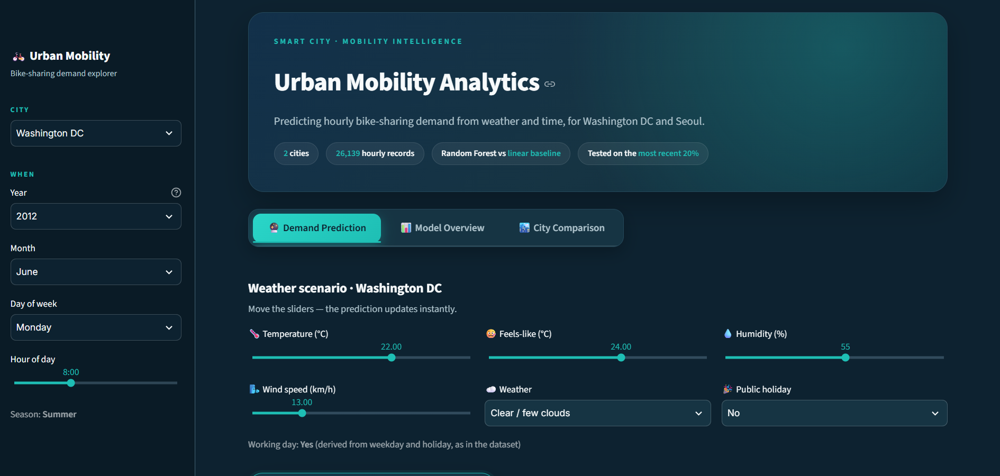
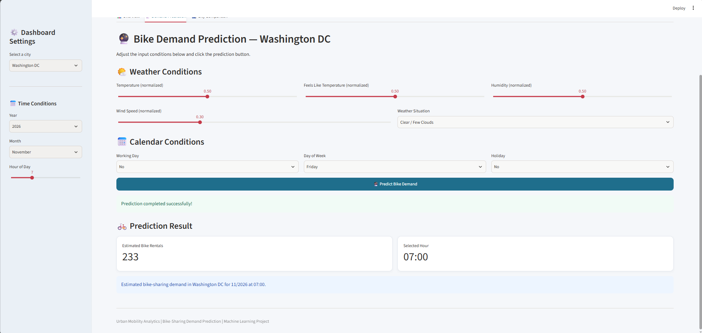
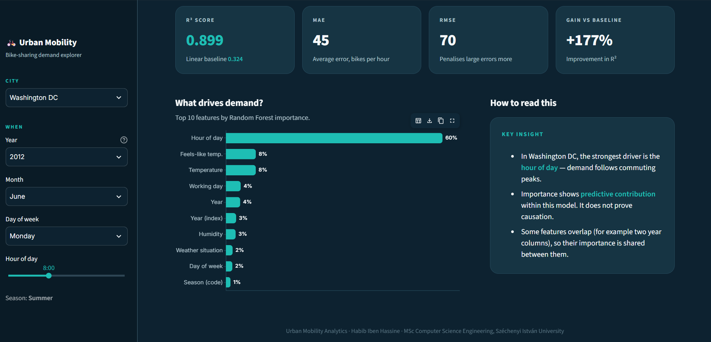
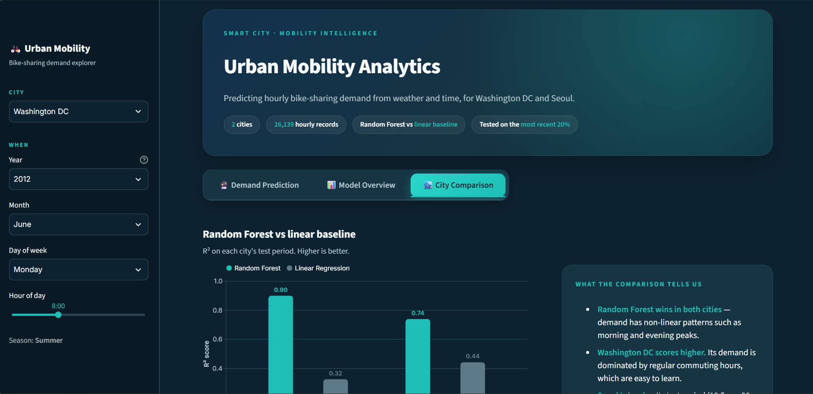

# Urban Mobility Analytics
### Bike-Sharing Demand Prediction Using Weather and Temporal Data

A machine learning project that analyzes and predicts bike-sharing demand using weather conditions and temporal features. The project compares bike rental demand patterns and prediction performance across two cities: **Washington DC** and **Seoul**.


The application provides an interactive dashboard built with Streamlit, allowing users to adjust weather and time conditions, see live bike demand predictions, and explore model performance.

---

**Project Type:** Individual MSc Project  
**Domain:** Machine Learning · Urban Mobility · Data Analytics  
**Models:** Random Forest Regression (with a Linear Regression baseline)
**Cities:** Washington DC 🇺🇸 · Seoul 🇰🇷
## Dashboard Preview



## Table of Contents

- [Project Objectives](#project-objectives)
- [Dashboard Preview](#dashboard-preview)
- [Datasets](#datasets)
- [Technologies & Tools](#technologies--tools)
- [Machine Learning Methodology](#machine-learning-methodology)
- [Model Results & Performance](#model-results--performance)
- [Project Structure](#project-structure)
- [Dashboard Features](#dashboard-features)
- [Installation & Setup](#installation--setup)
- [Usage Guide](#usage-guide)
- [Limitations & Future Improvements](#limitations--future-improvements)
- [Conclusion](#conclusion)

## Project Objectives

The main objectives of this project are:

- Analyze bike-sharing demand using weather-related and temporal data.
- Explore the relationship between environmental conditions and bike rental behavior.
- Develop machine learning models to predict bike-sharing demand.
- Train and evaluate Random Forest regression models for Washington DC and Seoul.
- Compare the predictive performance of the models using R², Mean Absolute Error (MAE), and Root Mean Squared Error (RMSE).
- Identify the most influential features affecting bike rental demand.
- Develop an interactive dashboard that allows users to explore conditions and generate demand predictions.

## Datasets

This project uses two bike-sharing datasets from different cities to analyze and predict rental demand.

### 1. Washington DC — Capital Bikeshare

The Washington DC dataset contains bike-sharing rental information, including temporal variables, weather conditions, and calendar-related features.

**Features include:**
- Season, year, month, and hour
- Holiday and working-day information
- Weather situation
- Temperature and feels-like temperature
- Humidity
- Wind speed

**Target variable:** Bike rental demand (`cnt`)

**Period:** hourly records, 1 January 2011 – 31 December 2012 (17,379 rows)

**Source:** [UCI Machine Learning Repository — Bike Sharing Dataset](https://archive.ics.uci.edu/dataset/275/bike+sharing+dataset) (Fanaee-T & Gama, 2013). The `casual` and `registered` columns are removed before training because they add up to the target.

### 2. Seoul — Seoul Bike Sharing

The Seoul dataset contains bike rental records combined with weather conditions and temporal information.

**Features include:**
- Hour
- Temperature
- Humidity
- Wind speed
- Visibility
- Dew point temperature
- Solar radiation
- Rainfall and snowfall
- Weekday
- Holiday information
- Functioning day (whether the bike system was operating; rentals are always 0 when it was not)
- Seasonal information

**Target variable:** Bike rental demand (`Rented Bike Count`)

**Period:** hourly records, 1 December 2017 – 30 November 2018 (8,760 rows)

**Source:** [UCI Machine Learning Repository — Seoul Bike Sharing Demand](https://archive.ics.uci.edu/dataset/560/seoul+bike+sharing+demand) (Sathishkumar V E, Park & Cho, 2020).

### Dataset Comparison

The two datasets allow the project to explore bike-sharing demand in different urban environments. However, they have different data distributions and demand scales, so their prediction errors should be interpreted within each dataset rather than compared directly.

## Technologies & Tools

### Programming Language
- **Python** — Data processing, analysis, model training, and application development.

### Data Analysis & Processing
- **Pandas** — Data manipulation and preprocessing.
- **NumPy** — Numerical operations and data handling.

### Machine Learning
- **Scikit-learn** — Random Forest regression, model training, and evaluation.
- **Joblib** — Saving and loading trained machine learning models.

### Data Visualization
- **Matplotlib & Seaborn** — Exploratory plots in the notebook.
- **Altair** — Interactive charts in the dashboard.

### Web Application
- **Streamlit** — Development of the interactive dashboard for predictions, model evaluation, and city comparison.

### Development Environment
- **Jupyter Notebook** — Exploratory data analysis and experimentation.
- **Visual Studio Code** — Development and project management.

## Machine Learning Methodology

The project follows a machine learning workflow to analyze bike-sharing demand and predict the number of bike rentals based on temporal and weather-related features.

### 1. Data Preparation

The datasets are prepared for machine learning by organizing the relevant temporal, weather, and calendar information into suitable input features for each model.

### 2. Feature Engineering

Additional features are used to capture demand patterns, including:

- Hour, day of the week, month, and year
- Weekend and working-day indicators
- Seasonal information
- Weather-related variables such as temperature, humidity, wind speed, and precipitation

### 3. Train/Test Split

Each dataset is sorted by date and hour and split **chronologically**: the first 80% of the timeline is used for training and the most recent 20% for testing. This mimics real forecasting (the model never sees "future" data) and avoids the overly optimistic scores of a random split on time-series data.

| City | Training rows | Test rows | Test period |
|---|---:|---:|---|
| Washington DC | 13,903 | 3,476 | 7 Aug 2012 – 31 Dec 2012 |
| Seoul | 7,008 | 1,752 | 19 Sep 2018 – 30 Nov 2018 |

### 4. Model Training

Two models are trained separately for each city:

- **Linear Regression** — a simple baseline.
- **Random Forest Regressor** (100 trees, `random_state=42`) — the main model, able to capture non-linear patterns such as commuting peaks.

### 5. Model Evaluation

The trained models are evaluated on the test set using three regression metrics:

- **R² Score:** Measures how well the model explains the variation in bike rental demand.
- **Mean Absolute Error (MAE):** Measures the average absolute difference between predicted and actual rental values.
- **Root Mean Squared Error (RMSE):** Measures prediction error while giving greater weight to larger errors.

### 6. Model Deployment

All steps are scripted in `src/train.py`. The trained models are saved using Joblib (compressed) and integrated into a Streamlit application. Users can select a city, adjust temporal and weather conditions, and obtain predicted bike-sharing demand through the interactive dashboard.

## Model Results & Performance

The performance of the Random Forest models was evaluated using R², Mean Absolute Error (MAE), and Root Mean Squared Error (RMSE).

### Performance Summary

| City | Model | R² Score | MAE | RMSE |
|---|---|---:|---:|---:|
| Washington DC | Linear Regression (baseline) | 0.3244 | 137.63 | 181.22 |
| Washington DC | **Random Forest** | **0.8993** | **45.47** | **69.95** |
| Seoul | Linear Regression (baseline) | 0.4409 | 334.35 | 458.62 |
| Seoul | **Random Forest** | **0.7383** | **216.91** | **313.77** |

Random Forest clearly outperforms the linear baseline in both cities.

### Washington DC

The Washington DC model achieved an R² score of **0.8993**, demonstrating strong predictive performance. The most important features are **hour of day (0.60)**, feels-like temperature (0.08) and temperature (0.08): demand in Washington DC is dominated by regular commuting patterns.

### Seoul

The Seoul model achieved an R² score of **0.7383**. The model provides a reasonable level of predictive performance, although demand is harder to predict than in Washington DC. The most important features are **temperature (0.38)**, hour of day (0.29) and solar radiation (0.09): demand in Seoul is driven more by weather.

Two properties of the Seoul test period help explain the lower score:

- It covers **October and November**, months that never appear in the training data (the dataset spans only one year).
- It contains **223 of the 295 hours** in which the bike system was not operating (zero rentals), while only 72 such hours are in the training data.

### Interpretation

The Washington DC model achieved better predictive performance based on its R² score. However, MAE and RMSE should not be directly compared between the two cities because the datasets have different demand scales and distributions.

The results demonstrate the potential of weather and temporal information for predicting bike-sharing demand and supporting urban mobility analysis.

## Project Structure

The project is organized into directories for datasets, notebooks, trained models, reports, and the interactive dashboard.

```text
Urban-Mobility-Analytics/
│
├── data/
│   ├── raw/
│   │   ├── hour.csv
│   │   └── SeoulBikeData.csv
│   └── processed/
│
├── src/
│   └── train.py
│
├── notebooks/
│   └── 01_data_understanding.ipynb
│
├── models/
│   ├── washington_rf_model.pkl
│   └── seoul_rf_model.pkl
│
├── reports/
│   ├── washington_feature_importance.csv
│   ├── seoul_feature_importance.csv
│   └── model_comparison.csv
│
├── screenshots/
│   ├── dashboard_header.png
│   ├── demand_prediction.png
│   ├── overview.png
│   ├── overview_details.png
│   ├── city_comparison.png
│   └── comparison_details.png
│
├── dashboard/
│   └── app.py
│
├── .streamlit/
│   └── config.toml
│
├── README.md
└── requirements.txt
```

### Directory Description

- **data/raw/** — Contains the original datasets (`hour.csv` and `SeoulBikeData.csv`).
- **data/processed/** — Reserved for preprocessed datasets (empty by default).
- **src/train.py** — Reproducible pipeline: data cleaning, feature engineering, chronological split, training, evaluation, and saving of models and reports.
- **notebooks/** — Contains notebooks used for exploratory data analysis and experimentation.
- **models/** — Stores the trained Random Forest models for Washington DC and Seoul (regenerate with `python src/train.py`).
- **reports/** — Contains model comparison results and feature importance reports.
- **dashboard/** — Contains the Streamlit application.
- **.streamlit/config.toml** — Dashboard colour theme.
- **README.md** — Provides project documentation.
- **requirements.txt** — Lists the Python dependencies required to run the project.

## Dashboard Features

The interactive Streamlit dashboard uses a dark theme that matches the project presentation (`.streamlit/config.toml`). It has three tabs.

### Demand Prediction

Users describe a scenario and the prediction **updates instantly** as they move the sliders.

**Both cities (sidebar):** city, year, month, day of week and hour. The season is derived from the month. Only years covered by each city's training data can be selected, because Random Forest models cannot extrapolate to later years.

**Washington DC:**
- Temperature and feels-like temperature (°C), humidity (%), wind speed (km/h) — converted internally to the dataset's normalised scale.
- Weather situation and public holiday; the working-day flag is derived from weekday and holiday, as in the original dataset.

**Seoul:**
- Temperature, humidity, wind speed and rainfall, plus visibility, dew point, solar radiation and snowfall under "More weather conditions".
- Public holiday and whether the bike system is operating (if not, the dashboard returns 0 rentals, matching the data).

The result card shows the estimated rentals for that hour and compares it with the **historical average for the same hour** (for example, "▲ 79% vs a typical 08:00"). A chart shows the average daily demand curve with the scenario highlighted.

### Model Overview

- R², MAE and RMSE of the selected city's Random Forest on the test period.
- The Linear Regression baseline and the improvement over it.
- A chart of the top 10 features by importance, with readable feature names.

### City Comparison

- Grouped bar chart of R² for Random Forest and Linear Regression in both cities.
- An interpretation of the differences between the cities.
- A full results table, loaded from `reports/model_comparison.csv`.

## Installation & Setup

Follow these steps to run Urban Mobility Analytics locally.

### 1. Clone the Repository

```bash
git clone https://github.com/benhassinehabib/urban-mobility-analytics.git
cd urban-mobility-analytics
```

### 2. Create a Virtual Environment

```bash
python -m venv venv
```

Activate the virtual environment:

**Windows:**
```bash
venv\Scripts\activate
```

**Linux / macOS:**
```bash
source venv/bin/activate
```

### 3. Install Dependencies

```bash
pip install -r requirements.txt
```

### 4. Train the Models

```bash
python src/train.py
```

This rebuilds both models and all files in `reports/` from the raw data in about 10 seconds, and prints the evaluation results.

### 5. Run the Dashboard

```bash
streamlit run dashboard/app.py
```

The application will open in your browser. If it does not open automatically, use the local URL provided in the terminal, usually:

```text
http://localhost:8501
```

### Requirements

- Python 3.10 or newer
- pip
- Git
- A web browser

## Usage Guide

1. **Choose a scenario in the sidebar:** city, year, month, day of week and hour.
2. **Demand Prediction tab:** adjust the weather conditions. The estimated demand and the comparison with a typical day update immediately.
3. **Model Overview tab:** see how accurate the selected city's model is and which features drive its predictions.
4. **City Comparison tab:** compare both cities and both models.

Predictions are estimates based on historical patterns learned from the training data. They are not guaranteed rental counts.

## Limitations & Future Improvements

### Limitations

Despite achieving promising results, the project has several limitations:

- **Dataset limitations:** The models rely on historical datasets, which may not fully represent current bike-sharing demand patterns.
- **City-specific models:** Separate models were trained for Washington DC and Seoul. Their differences in data structure, demand scale, and urban environment limit direct comparison.
- **Prediction accuracy:** The models cannot perfectly predict demand because bike-sharing behavior may be influenced by factors not included in the datasets.
- **Weather variability:** Sudden weather changes and extreme conditions may affect actual rental demand differently from the patterns learned during training.
- **Temporal limitations:** Historical temporal patterns may not accurately reflect future changes in user behavior, transportation infrastructure, or mobility trends.
- **No real-time data integration:** The application currently relies on manually selected input conditions rather than live weather information or real-time bike-sharing data.
- **Fixed time range:** The models only know the years in their training data (2011–2012 for Washington DC, Dec 2017 – Nov 2018 for Seoul). Predicting recent years requires retraining on recent data, which `src/train.py` makes straightforward.

### Future Improvements

Potential improvements to the project include:

- **Model optimization:** Experiment with additional algorithms such as Gradient Boosting, XGBoost, LightGBM, and other regression techniques.
- **Hyperparameter tuning:** Optimize Random Forest parameters to improve predictive performance.
- **Retraining on recent data:** Both bike-sharing systems publish newer data; retraining with the existing pipeline would produce up-to-date models.
- **Real-time data integration:** Connect the dashboard to live weather APIs and bike-sharing data sources.
- **Advanced feature engineering:** Incorporate additional features such as public events, traffic conditions, holidays, and special occasions.
- **Time-series forecasting:** Explore time-series models to capture temporal dependencies and long-term demand patterns.
- **Deployment:** Deploy the Streamlit application to a cloud platform to make it publicly accessible.
- **Scalability:** Extend the analysis to additional cities and bike-sharing systems to evaluate model generalization across different urban environments.

## Conclusion

This project explores the application of machine learning to bike-sharing demand prediction using weather conditions and temporal data. By analyzing datasets from Washington DC and Seoul, it demonstrates how environmental and time-related factors can contribute to understanding urban mobility patterns.

Random Forest regression models were developed for both cities and evaluated using R², Mean Absolute Error (MAE), and Root Mean Squared Error (RMSE). The results show promising predictive performance, particularly for the Washington DC dataset, while highlighting the challenges of predicting bike-sharing demand across different urban environments.

The project also provides an interactive Streamlit dashboard that enables users to explore model performance, investigate feature importance, compare cities, and generate predictions under different conditions.

Overall, this project demonstrates the potential of machine learning and data analytics in supporting urban mobility analysis and providing insights that could contribute to smarter, more data-driven transportation systems.

### Demand Prediction

Adjust the weather and time conditions; the estimate updates instantly and is compared with a typical day.



### Model Overview

Model performance against the baseline and the main drivers of demand.




### City Comparison

Random Forest vs Linear Regression in both cities, with an interpretation and the full results table.



